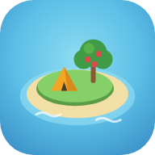
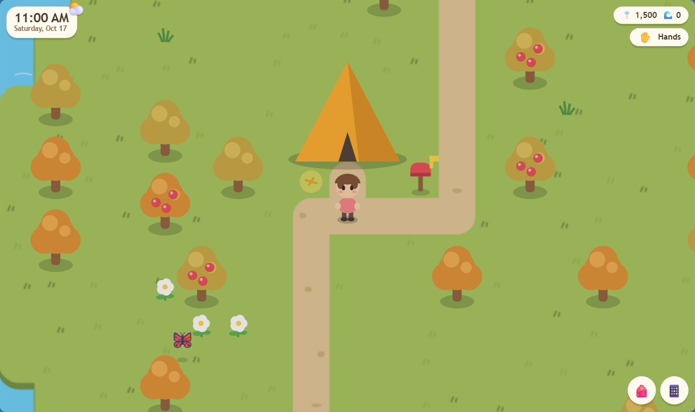
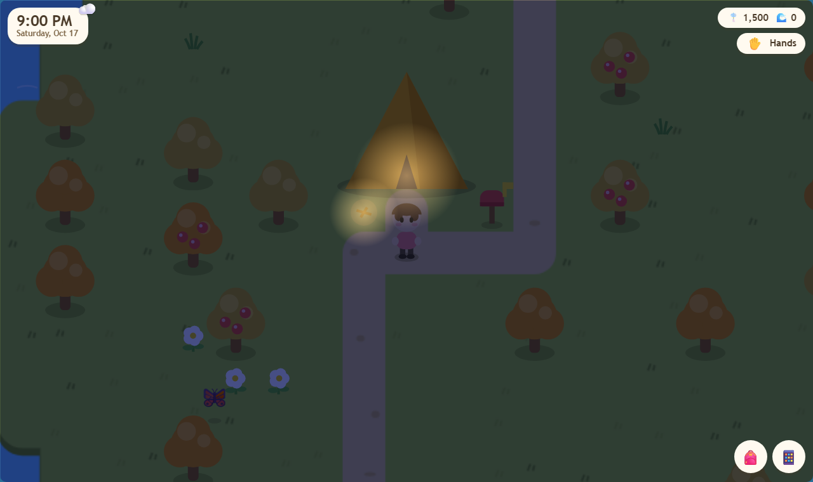
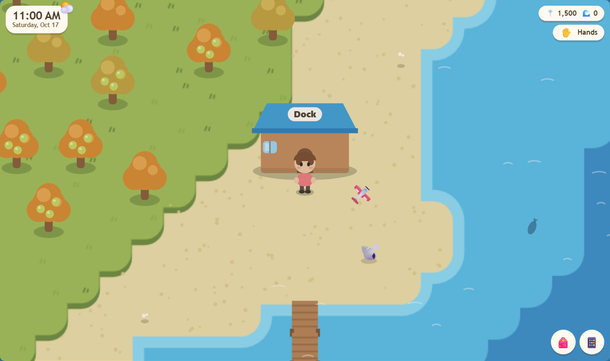
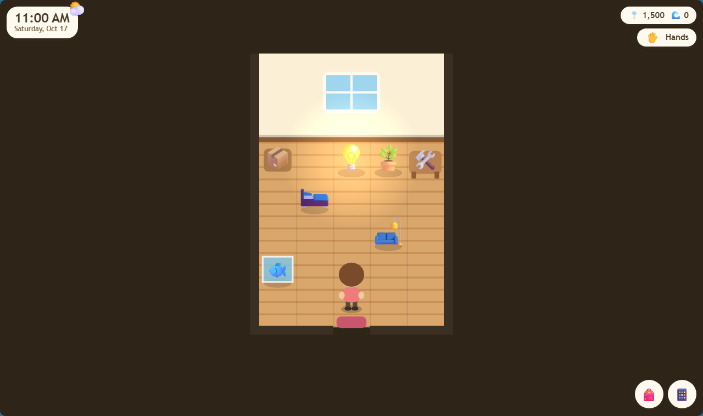
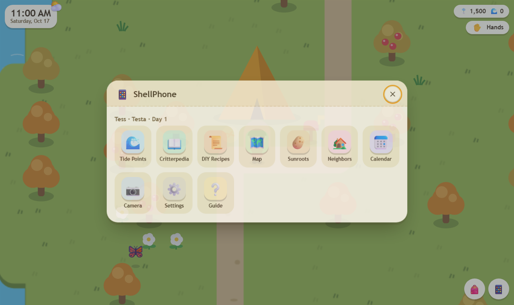

<div align="center">



# Puddlewick Isle

**A cozy island life sim that runs in your browser on your real-world clock.**
Fish, catch bugs, dig up fossils, befriend neighbors, play the sunroot market and grow a tent into a manor.

### ▶ [Play now at qamotech.github.io/pi](https://qamotech.github.io/pi/)

No install, no account, no ads. Works on desktop and phones, and plays offline once loaded.



</div>

## Features

| | |
|---|---|
| 🕰️ **Real-time island** | Days, seasons and hours follow your clock (new day at 5 AM). Pick the Northern or Southern hemisphere. Weather is seeded per day, with rain and snow. |
| 🎣 **Fishing** | 38 fish across river, pond and sea. Watch the shadow size, cast in front of a fish's face, wait out the nibbles, and strike when the bobber sinks. |
| 🦋 **Bug catching** | 34 bugs on flowers, trees, rocks, beaches and ponds. Tiptoe up, since running scares them. Beware wasp nests and the night-time tarantula. |
| 🦉 **Museum** | An owl curator identifies fossils and builds fish, bug and fossil halls from your donations. The Critterpedia shows what's catchable right now. |
| 🛠️ **DIY crafting** | About 30 recipes, including breakable tools in flimsy and sturdy tiers. Find recipes in message bottles, balloon presents, from neighbors and in the store. |
| 🦡 **Bramble's store** | Daily rotating furniture, wallpaper and flooring, seeds and tools. A double-price hot item every day, and a drop-off box after hours. |
| 🥔 **Sunroot market** | Buy on Sunday mornings and sell Monday to Saturday. Prices follow four hidden weekly patterns (big spike, small spike, decreasing, random). Sunroots spoil after a week. |
| 🏡 **Neighbors** | 16 original characters with 8 personalities. Friendship, gifts, requests, birthdays, letters and photos. Invite campers from mystery islands to move in. |
| 🏠 **Home** | Grow a tent into a manor with interest-free loans. Place furniture, fish tanks and bug cases, change wallpaper and floors, and use storage. |
| 🌸 **Gardening** | Plant and water flowers. Watered neighbors of the same species can breed hybrid colors. Plant fruit trees and saplings. |
| 🌊 **Tide Points** | 22 achievements plus 5 daily tasks. Spend points on bigger pockets, better tools and mystery-island tickets. |
| 📱 **ShellPhone** | Map, Critterpedia, DIY recipes, sunroot chart, neighbors, calendar, camera mode, settings (including time travel) and a guide. |
| 🏆 **Saturday Derby** | Every Saturday from 9 AM to 6 PM, Marlowe the otter runs 3-minute Fishing Derby and Bug-Off rounds in the plaza, alternating weekly. Win Tide Points and bronze, silver and gold trophies. |
| 🏵️ **Isle Bloom rating** | Hazel at Town Hall rates your island from 0 to 5 stars and suggests improvements. Each new star mails a one-time reward. |
| ✨ **Island life** | Shake trees, break rocks, pop balloons with a slingshot, wish on shooting stars, watch Sunday fireworks in August, trick-or-treat on Halloween. |

<p align="center">
  
  
  <br>
  
  
</p>

## How to play

| Action | Keyboard | Touch |
|---|---|---|
| Move | WASD or arrow keys | Left stick |
| Run / tiptoe | Hold Shift / hold Ctrl | 🏃 toggle / tilt the stick slightly |
| Talk, pick up, shake, use tool | Space or E | **A** |
| Switch tools | Q / R, or 1–6 | 🔧 |
| Put tool away | F | ✋ |
| Pockets / ShellPhone / Map | I / P / M | 🎒 / 📱 |
| Wish on a shooting star | Y | 🌠 |

Progress saves automatically in your browser. Use **ShellPhone → Settings** to export or import a save file.

## Install as an app

Open the game in Chrome, Edge or Safari and choose **Install app** or **Add to Home Screen**. It then runs full-screen, and works offline thanks to the service worker.

## Under the hood

- One self-contained `index.html`: canvas rendering, procedural art, generative WebAudio music and sound effects. It has no dependencies and makes no network calls, so the strict Content-Security-Policy blocks everything external.
- Islands are generated from a seed: terrain, river, bridges, ponds, buildings, BFS-connected paths and nature.
- [`tests/run.sh`](tests/run.sh) runs the headless-Chrome test suite: smoke, gameplay and feature harnesses with about 60 assertions.

```bash
bash tests/run.sh      # needs Google Chrome (set CHROME=/path/to/chrome) plus python and node
```

## Changelog

The game is upgraded continuously. Each release adds new features and polish; see [CHANGELOG.md](CHANGELOG.md).

## Credits

Created by [qamotech](https://github.com/qamotech), built with Claude Code. An original fan-made homage to cozy island life sims; it is not affiliated with or endorsed by Nintendo. Released under the [MIT License](LICENSE).
